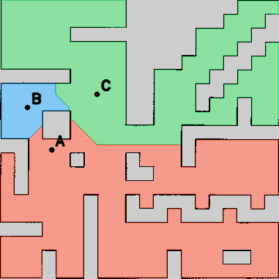

# Bài TH Tuần 7 — Phân vùng bản đồ và điều hướng bằng giọng nói

Nhánh **`BaiTHTuan7`**, môi trường Ubuntu 22.04, ROS 2 Humble và TurtleBot 4
Simulation (world `maze`). Robot nhận câu lệnh tiếng Việt, xác định khu vực
và tự điều hướng bằng Nav2.

## 1. Thành phần và phương pháp

```text
src/
├── tht4_tb4_nav/     # Gazebo, AMCL, Nav2 và bản đồ bài trước
└── tht7_tb4/         # Phân vùng, nhãn, Whisper và điều hướng giọng nói
```

- **Phân vùng:** OpenCV đọc Occupancy Grid, xác định ô trống theo `map.yaml`;
  BFS nhiều nguồn chia vùng theo khoảng cách đường đi 4 hướng từ các hạt giống.
  Vùng không xuyên tường; tên phòng là nhãn chức năng minh họa, không tự nhận
  diện loại phòng. Chuyển pixel sang tọa độ `map` theo resolution và origin.
- **Gắn nhãn:** [regions.yaml](src/tht7_tb4/config/regions.yaml) lưu ID, tên,
  aliases và đích `(x, y, yaw)`. A = Phòng học, B = Phòng thí nghiệm,
  C = Hành lang. Điểm đích cần cách vật cản ít nhất 0,30 m.
- **Giọng nói:** Whisper chạy cục bộ chuyển âm thanh tiếng Việt thành văn bản.
- **Điều hướng:** phân tích câu → danh sách vùng → action `NavigateToPose`.
  Lệnh từ A đến B luôn qua A trước, chỉ đi tiếp B khi A thành công.
  Vùng không tồn tại trả `INVALID`, không gửi goal. Lệnh mới khi đang đi trả `BUSY`.



| Dữ liệu | File |
|---|---|
| Ảnh bản đồ gốc và cấu hình dùng cho bài 7 | [map.pgm](src/tht7_tb4/config/map.pgm), [map.yaml](src/tht7_tb4/config/map.yaml) |
| Bản đồ phân vùng để xem | [segmented_map.png](src/tht7_tb4/results/segmented_map.png) |
| Nhãn đầy đủ các ô vùng (1/2/3 = A/B/C, 0 = chưa gán) | [region_labels.png](src/tht7_tb4/results/region_labels.png) |
| Diện tích, đích và thông tin bản đồ | [segmentation.yaml](src/tht7_tb4/results/segmentation.yaml) |

Ảnh gốc được sao từ bài 4; ngưỡng free của bài 7 giữ màu xám 205 là unknown.
RViz dùng chữ không dấu để tránh lỗi font, lệnh giọng nói vẫn dùng tiếng Việt.

## 2. Cài đặt và build

Cần có TurtleBot 4 Ignition Simulator và Nav2 từ bài trước. Trên máy mới:

```bash
git clone --branch BaiTHTuan7 https://github.com/tuanvu162/tht4_tb4_ws.git ~/tht4_tb4_ws
```

Nếu đã có workspace thì bỏ qua clone. Build cả hai package:

```bash
cd ~/tht4_tb4_ws
source /opt/ros/humble/setup.bash
rosdep install --from-paths src/tht4_tb4_nav src/tht7_tb4 --ignore-src -r -y
PYTHONNOUSERSITE=1 colcon build --packages-select tht4_tb4_nav tht7_tb4 --symlink-install
```

Cài môi trường nhận giọng nói một lần bằng Python 3.10:

```bash
sudo apt install python3-venv ffmpeg libportaudio2
cd ~/tht4_tb4_ws
/usr/bin/python3 -m venv --system-site-packages .venv-tht7
source .venv-tht7/bin/activate
python -m pip install --upgrade pip 'setuptools<80' wheel packaging
python -m pip install torch --index-url https://download.pytorch.org/whl/cpu
python -m pip install -r src/tht7_tb4/requirements-voice.txt
```

## 3. Chạy chương trình

Trong **mỗi terminal ROS**, chạy:

```bash
cd ~/tht4_tb4_ws
source /opt/ros/humble/setup.bash
source install/setup.bash
export ROS_DOMAIN_ID=30
```

**Terminal 1 — mở mô phỏng, bản đồ có nhãn và Nav2:**

```bash
ros2 launch tht7_tb4 tht7.launch.py
```

Máy không có GPU/driver NVIDIA dùng `use_nvidia:=false`. Trong RViz đặt
**2D Pose Estimate**, kiểm tra LiDAR khớp tường và robot sẵn sàng di chuyển.
Gazebo phải ở trạng thái Play; dừng teleop và các node điều hướng khác.

**Terminal 2 — nhận lệnh bằng micro:**

```bash
source .venv-tht7/bin/activate
python -m tht7_tb4.speech_input --model small --seconds 5
```

Lần đầu cần mạng tải model. Nhấn **Enter**, nói trong 5 giây, đợi kết quả.
Gõ `q` để thoát. Có thể liệt kê micro bằng `--list-devices`, chọn bằng `--device 2`.

| Câu nói mẫu | Hành vi |
|---|---|
| Đi đến khu vực A. | Đi tới A |
| Đi đến phòng thí nghiệm. | Đi tới B |
| Đi đến hành lang. | Đi tới C |
| Di chuyển từ khu vực A đến khu vực B. | Qua A, chờ thành công, rồi tới B |
| Đi đến khu vực Z. | Báo vùng không tồn tại, không gửi đích |
| Dừng lại. | Yêu cầu hủy goal và xóa tuyến còn lại |

**Terminal 3 — theo dõi trạng thái:**

```bash
ros2 topic echo /voice_navigation/status std_msgs/msg/String \
  --qos-durability transient_local
```

Có thể thử riêng điều hướng bằng văn bản trước khi dùng micro:

```bash
ros2 run tht7_tb4 send_command 'Đi đến khu vực A.'
```

Luồng: `micro → Whisper → /voice_command → voice_navigation → /navigate_to_pose → Nav2`.
`/semantic_regions` hiển thị vùng trên RViz; `/voice_navigation/status` báo
`ARRIVED`, `SUCCEEDED`, `INVALID`, `FAILED` hoặc trạng thái hủy. Nếu mất scan,
quá thời gian hoặc goal thất bại, chương trình dừng tuyến/yêu cầu hủy phù hợp.

## 4. Đổi khu vực và tạo lại bản đồ phân vùng

Sửa tên, aliases, đích trong `src/tht7_tb4/config/regions.yaml`. Đích cũng là
hạt giống phân vùng nên đổi đích sẽ đổi ranh giới vùng. Tạo lại ảnh:

```bash
ros2 run tht7_tb4 segment_map --output "$PWD/src/tht7_tb4/results"
```

Khởi động lại launch sau khi đổi cấu hình. Chi tiết thêm tại
[README package](src/tht7_tb4/README.md).

## 5. Kiểm tra và nội dung nộp

```bash
/usr/bin/python3 -m pytest src/tht7_tb4/test -q
```

Kiểm thử kiểm tra phân vùng, câu lệnh và giao tiếp với action server giả;
cần quay demo thực tế để chứng minh robot di chuyển và tránh vật cản.

- Video demo: bản đồ có ít nhất 3 vùng; nói ít nhất 3 câu; robot tới đúng vùng;
  tuyến A → B; thử khu vực không tồn tại. Quay cả văn bản nhận dạng và robot chạy.
- PDF **1–2 trang**: phương pháp segmentation, chuyển tọa độ, nhận dạng giọng
  nói, luồng điều hướng, ảnh/kết quả thử nghiệm và link video/GitHub.
- Source, bản đồ và cấu hình trong nhánh này. Không upload môi trường Python,
  build/log hoặc trọng số Whisper đã tải.

**Video demo:** chưa bổ sung.

- [Báo cáo tóm tắt 2 trang](src/tht7_tb4/report/Bao_cao_BaiTH_Tuan7.pdf)
- [Báo cáo chi tiết 8 trang](src/tht7_tb4/report/Bao_cao_chi_tiet_BaiTH_Tuan7.pdf)
- [Sơ đồ kiến trúc](src/tht7_tb4/report/So_do_kien_truc_THT7.png)
