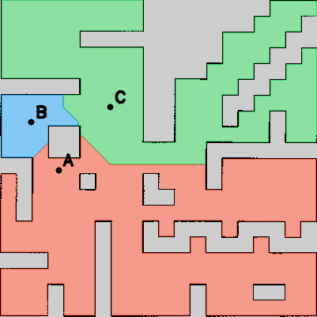

# BÁO CÁO BÀI THỰC HÀNH 7

## Phân vùng bản đồ và điều hướng robot bằng giọng nói

**Họ và tên:** ................................  **MSSV:** ........................

**Lớp:** ................................

## 1. Mục tiêu và môi trường

Xây dựng hệ thống phân vùng bản đồ Occupancy Grid thành tối thiểu ba khu vực có nhãn, nhận câu lệnh tiếng Việt và gửi đích điều hướng cho Nav2. Môi trường sử dụng Ubuntu 22.04, ROS 2 Humble, TurtleBot 4 Simulation và world maze. Package tht7_tb4 dùng lại Gazebo, AMCL và Nav2 từ tht4_tb4_nav.

## 2. Phương pháp phân vùng và gắn nhãn

OpenCV đọc ảnh map.pgm và phân loại ô theo map.yaml: resolution 0,05 m/pixel, origin (-10,1; -10,1; 0), free_thresh = 0,196 và occupied_thresh = 0,65. Các ô xám 205 được giữ ở trạng thái chưa biết. Thuật toán BFS nhiều nguồn lan truyền từ ba hạt giống A/B/C trên các ô trống theo bốn hướng. Mỗi ô được gán cho hạt giống có khoảng cách đường đi ngắn nhất; khi bằng nhau, thứ tự hạt giống quyết định nhãn. Đây là phân vùng chức năng có hạt giống, không tự suy luận loại phòng từ cấu trúc kiến trúc.

Với ảnh cao H, pixel (u, v), độ phân giải r và origin không xoay của bản đồ hiện tại: x = ox + (u + 0,5)r; y = oy + (H − v − 0,5)r. YAML lưu ID, tên, aliases và đích (x, y, yaw); điểm đích đồng thời là hạt giống. Chương trình kiểm tra ô trống, khoảng cách tới vật cản tối thiểu 0,30 m và tính liên thông giữa các đích. Khoảng cách này không thay thế kiểm tra footprint và costmap của Nav2.

| Vùng | Tên | x (m) | y (m) | yaw (rad) | Diện tích (m²) |
|---|---|---:|---:|---:|---:|
| A | Phòng học | -6.38 | -0.85 | 0.0 | 152.14 |
| B | Phòng thí nghiệm | -8.12 | 2.23 | 0.0 | 13.74 |
| C | Hành lang | -3.12 | 3.19 | 0.0 | 113.29 |



Ảnh nhãn đầy đủ lưu trong `results/region_labels.png`; thông tin vùng, diện tích và tọa độ lưu trong `results/segmentation.yaml`. RViz hiển thị ô vùng, nhãn và mũi tên đích qua `/semantic_regions`; chữ hiển thị không dấu để tránh lỗi font.

## 3. Nhận dạng giọng nói và điều hướng

Người dùng nhấn Enter để thu một câu trong 5 giây bằng micro, mono 16 kHz. Whisper đa ngôn ngữ (mặc định small, language=vi) chạy cục bộ và chuyển âm thanh thành văn bản; lần đầu cần mạng để tải model. Bộ phân tích chuẩn hóa chữ hoa/thường, dấu tiếng Việt và dấu câu, rồi đối chiếu tên/aliases trong regions.yaml. Chỉ câu khớp đầy đủ mới được chuyển thành tuyến; câu có vùng lạ bị từ chối toàn bộ.

Node voice_navigation nhận /voice_command, kiểm tra AMCL, đồng hồ mô phỏng, LiDAR, TF và action server. Mỗi đích được đổi thành PoseStamped trong frame map, với quaternion qz = sin(yaw/2), qw = cos(yaw/2), rồi gửi qua NavigateToPose. Lệnh “từ A đến B” gửi A trước kể cả robot đang ở vùng khác; chỉ khi A SUCCEEDED mới gửi B. Nav2 lập đường đi và điều khiển tránh vật cản. Nếu thất bại, mất dữ liệu scan hoặc quá thời gian, tuyến dừng và yêu cầu hủy khi cần. Lệnh “Dừng lại” hủy goal của node và xóa phần tuyến còn lại.

```text
Micro → Whisper → /voice_command → phân tích vùng → NavigateToPose → Nav2
```

**Thành phần chính:** `segmentation.py`, `regions.py`, `commands.py`, `speech_input.py`, `voice_navigation.py`, `region_markers.py`.

**Giao tiếp ROS:** `/voice_command` và `/voice_navigation/status` dùng `std_msgs/String`; `/semantic_regions` dùng `visualization_msgs/MarkerArray`; action `/navigate_to_pose` dùng `nav2_msgs/action/NavigateToPose`. AMCL và LiDAR cung cấp `/amcl_pose`, `/scan` và TF.

## 4. Kết quả kiểm tra và giới hạn

Đối chiếu lại bản đồ phân vùng đã lưu với cấu hình hiện tại cho thấy nhãn khớp nhau và có đủ ba vùng. Các đích A/B/C có khoảng cách tới vật cản lần lượt 0,80 m; 1,15 m; 2,06 m, đều lớn hơn 0,30 m. Có 16 ô trống rời rạc không nối với hạt giống nên không được gán vùng. Năm trường hợp phân tích văn bản bên dưới đã được kiểm tra trực tiếp với bộ phân tích câu lệnh.

| Câu lệnh văn bản | Kết quả phân tích đã kiểm tra |
|---|---|
| Đi đến khu vực A. | Tuyến [A] |
| Đi đến phòng thí nghiệm. | Tuyến [B] |
| Đi đến hành lang. | Tuyến [C] |
| Di chuyển từ khu vực A đến khu vực B. | Tuyến [A, B] |
| Đi đến khu vực Z. | INVALID; không gửi goal |

Kiểm tra trên xác nhận phân vùng và logic xử lý văn bản; chưa cung cấp số đo độ chính xác nhận giọng nói, thời gian di chuyển hoặc tỷ lệ tới đích từ phiên chạy thực tế. Cần đính kèm video ghi ít nhất ba câu nói, robot tới đúng vùng và tránh vật cản, tuyến A → B và trường hợp vùng không tồn tại. Độ chính xác giọng nói phụ thuộc micro và tiếng ồn; hỗ trợ câu “qua C rồi đến B” là hướng mở rộng, chưa triển khai.

## 5. Liên kết nộp bài

- GitHub: https://github.com/tuanvu162/tht4_tb4_ws/tree/BaiTHTuan7

- Video demo: **[Bổ sung link Google Drive công khai]**.

- Ảnh phân vùng minh họa trong báo cáo là kết quả xử lý bản đồ, không phải ảnh chụp robot đang điều hướng.