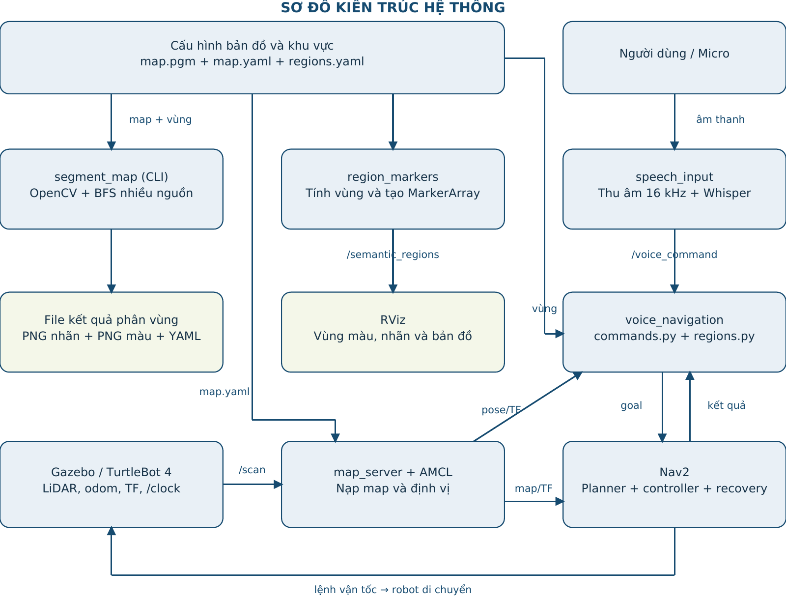
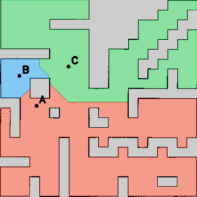

# BÁO CÁO CHI TIẾT BÀI THỰC HÀNH 7

## Phân vùng bản đồ và điều hướng robot bằng giọng nói

Họ và tên: ..............................................    MSSV: ..........................

Lớp: ......................................................

## 1. Mục tiêu, môi trường và cấu trúc chương trình

Hệ thống cho phép người dùng yêu cầu TurtleBot 4 đến một khu vực bằng tiếng Việt. Bản đồ Occupancy Grid đã tạo từ bài trước được chia thành A/B/C, gắn nhãn chức năng và liên kết với các đích hợp lệ. Câu nói được chuyển thành văn bản, phân tích thành tuyến và gửi tới Nav2 để robot tự lập kế hoạch di chuyển.

Môi trường: Ubuntu 22.04, ROS 2 Humble, TurtleBot 4 Simulation, Gazebo Fortress, world maze, AMCL và Nav2. Thư viện chính: rclpy, OpenCV, NumPy, PyYAML, sounddevice và Whisper đa ngôn ngữ. Model mặc định small chạy trên CPU; Gazebo/RViz có tùy chọn dùng GPU NVIDIA.

```text
src/
├── tht4_tb4_nav/        # Mô phỏng, map, AMCL và Nav2
└── tht7_tb4/
    ├── config/         # map.pgm, map.yaml, regions.yaml
    ├── launch/         # tht7.launch.py
    ├── tht7_tb4/       # Các module Python
    ├── results/        # PNG vùng, PNG nhãn, segmentation.yaml
    ├── rviz/           # semantic.rviz
    ├── test/           # Kiểm thử xử lý và ROS action
    └── report/         # Báo cáo và sơ đồ kiến trúc
```

| Module / file | Trách nhiệm |
| --- | --- |
| segmentation.py | Đọc map, đổi tọa độ, kiểm tra đích, BFS và xuất ảnh/metadata. |
| regions.py | Đọc YAML, kiểm tra ID/aliases/tọa độ và chuẩn hóa tiếng Việt. |
| commands.py | Phân tích câu thành tuyến vùng hoặc yêu cầu dừng. |
| speech_input.py | Thu âm, Whisper, publish văn bản; hỗ trợ file âm thanh và gửi text. |
| voice_navigation.py | Quản lý tuyến, action client, feedback, kết quả và hủy. |
| region_markers.py | Hiển thị vùng và đích trên RViz. |
| tht7.launch.py | Ghép các thành phần, tùy chọn mở Gazebo/Nav2 và NVIDIA. |

Hai package bài 4 và bài 7 được giữ cùng nhánh BaiTHTuan7 vì bài 7 cần launch mô phỏng và điều hướng của bài 4. Không cần chạy package YOLO của bài 5.

## 2. Sơ đồ kiến trúc và các node/package chính



Sơ đồ mô tả các đường dữ liệu chính, không liệt kê mọi node nội bộ Nav2. Nhánh phân vùng chạy từ file map/cấu hình; nhánh điều khiển chạy từ micro đến action điều hướng. voice_navigation nạp regions.yaml trực tiếp, không nhận tọa độ từ nhãn chữ trên RViz.

| Package / node | Giải thích vai trò |
| --- | --- |
| tht4_tb4_nav | Cung cấp launch Gazebo, RViz, map server, AMCL và Nav2. |
| tht7_tb4 | Tích hợp phân vùng, semantic mapping, nhận dạng giọng nói và điều hướng. |
| map_server + amcl | Nạp map; AMCL ước lượng pose từ bản đồ, LiDAR và chuyển động, cung cấp map → odom. |
| speech_input | Node ROS tiếp nhận một câu âm thanh, chạy Whisper và gửi /voice_command. |
| voice_navigation | Node điều phối tuyến; dùng ActionClient NavigateToPose, không tự lập đường tránh vật cản. |
| region_markers | Node tạo và publish MarkerArray; tính lại vùng từ map và YAML khi khởi động. |
| Nav2 + Gazebo | Nav2 lập kế hoạch, điều khiển và recovery; Gazebo mô phỏng robot, cảm biến và chuyển động. |

segment_map là chương trình dòng lệnh xử lý file ngoại tuyến. commands.py và regions.py là module dùng chung, không phải các node ROS độc lập. send_command là công cụ publish câu văn bản để kiểm tra riêng luồng điều hướng.

## 3. Các topic, action và luồng xử lý ROS

| Giao tiếp | Kiểu dữ liệu | Nguồn → nơi nhận / ý nghĩa |
| --- | --- | --- |
| /map | nav_msgs/msg/OccupancyGrid | map_server → AMCL, Nav2, RViz; bản đồ tĩnh. |
| /initialpose | geometry_msgs/msg/PoseWithCovarianceStamped | RViz → AMCL; vị trí/hướng ban đầu. |
| /amcl_pose | geometry_msgs/msg/PoseWithCovarianceStamped | AMCL → voice_navigation; nhận pose để kiểm tra đã định vị. |
| /scan | sensor_msgs/msg/LaserScan | LiDAR → AMCL, costmap và voice_navigation. |
| /tf, /tf_static | tf2_msgs/msg/TFMessage | Các frame map, odom, base_link và cảm biến. |
| /clock | rosgraph_msgs/msg/Clock | Gazebo → các node dùng use_sim_time. |
| /voice_command | std_msgs/msg/String | speech_input/send_command → voice_navigation; câu lệnh văn bản. |
| /voice_navigation/status | std_msgs/msg/String | voice_navigation → terminal; trạng thái và lỗi. |
| /semantic_regions | visualization_msgs/msg/MarkerArray | region_markers → RViz; ô vùng, nhãn và mũi tên. |
| /clicked_point | geometry_msgs/msg/PointStamped | RViz Publish Point → terminal lấy x, y. |
| /navigate_to_pose (action) | nav2_msgs/action/NavigateToPose | voice_navigation ↔ Nav2; goal, feedback, kết quả và yêu cầu hủy. |

### 3.1. Phân biệt topic và action

Topic dùng để truyền luồng dữ liệu hoặc trạng thái. NavigateToPose là action dài hạn: goal chứa PoseStamped và behavior_tree; feedback có distance_remaining; kết quả dùng trạng thái action để xác định SUCCEEDED, thất bại hoặc hủy. Không suy luận đã tới đích chỉ từ khoảng cách còn lại bằng 0.

### 3.2. QoS và điều kiện hoạt động

/semantic_regions và /voice_navigation/status dùng Transient Local, depth 1, giúp subscriber mới nhận mẫu gần nhất khi publisher vẫn sống. /scan dùng QoS cảm biến. Node chỉ kiểm tra đã có AMCL pose, TF map → base_link, scan nhận gần đây, clock khác 0 và action server sẵn sàng; chất lượng localization vẫn phải kiểm tra trên RViz.

Các tham số mặc định: goal_timeout = 180 giây thực mỗi đích, scan_timeout = 3 giây, response_timeout = 10 giây. Watchdog chạy mỗi 0,2 giây theo đồng hồ ổn định; mô phỏng bị pause vẫn có thể dẫn tới hủy vì scan cũ. Trạng thái READY ban đầu nghĩa là node đã khởi tạo và chờ lệnh, chưa đảm bảo Nav2 đã sẵn sàng.

## 4. Phương pháp segmentation và semantic mapping

### 4.1. Tiền xử lý bản đồ và kiểm tra đích

Đọc map.pgm dạng ảnh xám. Với negate = 0, xác suất chiếm dụng p = 1 − I/255. Ô trống khi p < free_thresh = 0,196; occupied_thresh = 0,65 xác định ngưỡng vật cản. Các ô còn lại không được đưa vào mặt nạ free. Cấu hình này giữ pixel 205 là unknown; free_thresh = 0,25 của bản đồ cũ sẽ coi pixel đó là free.

resolution = 0,05 m/pixel; origin = (-10,1; -10,1; 0). cv2.distanceTransform trên mặt nạ free, có đệm biên, ước lượng khoảng cách từ tâm ô đến ô không trống. Mỗi goal phải hữu hạn, nằm trong ảnh, thuộc free, có clearance ≥ 0,30 m; các seed khác ô và cùng thành phần liên thông. Kiểm tra này hỗ trợ chọn đích, không thay thế footprint/costmap.

### 4.2. Chia vùng bằng BFS nhiều nguồn

Khởi tạo ảnh nhãn uint16 bằng 0. Gán nhãn 1/2/3 cho các seed A/B/C và đưa cùng lúc vào hàng đợi. Lấy từng ô, duyệt bốn láng giềng trên/dưới/trái/phải; ô free chưa gán sẽ nhận nhãn của ô cha rồi được đưa vào hàng đợi. Khi hàng đợi rỗng, các vùng được chia theo số bước đường đi ngắn nhất. Nếu bằng nhau, thứ tự seed/láng giềng trong chương trình phá hòa. Các ô không nối seed giữ nhãn 0.

BFS có độ phức tạp O(H×W) cho ảnh H×W. Thuật toán tránh lan xuyên ô tường/unknown nhưng không tự phát hiện cửa hay ngữ nghĩa phòng; tên “Phòng học”, “Phòng thí nghiệm”, “Hành lang” là nhãn người dùng gán. Đổi goal cũng đổi seed và ranh giới vùng.

### 4.3. Chuyển pixel sang tọa độ ROS

Đặt lx = (u + 0,5)r; ly = (H − v − 0,5)r. Với origin (ox, oy, θ): x = ox + cosθ·lx − sinθ·ly; y = oy + sinθ·lx + cosθ·ly. Công thức dùng tâm pixel và đảo chiều trục ảnh. Chương trình hỗ trợ origin xoay; bản đồ hiện tại có θ = 0.

| Vùng | Đích (x, y, yaw) | Diện tích (m²) | Clearance (m) |
| --- | --- | --- | --- |
| A — Phòng học | (-6.38; -0.85; 0.0) | 152.14 | 0.80 |
| B — Phòng thí nghiệm | (-8.12; 2.23; 0.0) | 13.74 | 1.15 |
| C — Hành lang | (-3.12; 3.19; 0.0) | 113.29 | 2.06 |



Đầu ra: segmented_map.png để xem; region_labels.png lưu nhãn toàn bộ ô; segmentation.yaml lưu diện tích, goal, clearance, checksum map và số ô free chưa gán. regions.yaml lưu tên, ID, aliases, màu, goal và minimum_clearance.

## 5. Nhận dạng giọng nói và điều phối điều hướng

### 5.1. Tiếp nhận và chuyển giọng nói thành văn bản

speech_input dùng sounddevice thu mono float32 tại 16 kHz sau khi người dùng nhấn Enter, mặc định 5 giây. Whisper small đa ngôn ngữ chạy cục bộ, language=vi, task=transcribe, fp16=False, temperature=0. Model chỉ cần mạng khi tải lần đầu. Âm thanh rỗng/NaN/Inf bị từ chối; tín hiệu có RMS dưới 0,003 được bỏ qua để hạn chế gửi lệnh từ đoạn im lặng. Chương trình cũng hỗ trợ file âm thanh và liệt kê/chọn thiết bị micro.

### 5.2. Chuẩn hóa và hiểu câu lệnh

regions.py chuyển chữ thường, bỏ dấu tiếng Việt, đổi đ thành d và chuẩn hóa khoảng trắng. commands.py khớp đầy đủ các mẫu “đi đến X”, “di chuyển từ X đến Y” và câu dừng; đối chiếu cả tên phòng lẫn aliases như bê/bi/xê. Nếu có nguồn hoặc đích lạ, toàn bộ lệnh bị từ chối, không tự bỏ phần không hiểu. “Từ A đến A” được rút về một đích.

| Câu văn bản đã kiểm tra | Kết quả |
| --- | --- |
| Đi đến khu vực A. | [A] |
| Đi đến phòng thí nghiệm. | [B] |
| Đi đến hành lang. | [C] |
| Di chuyển từ khu vực A đến khu vực B. | [A, B] |
| Đi đến khu vực Z. | INVALID; không gửi goal |
| Di chuyển từ Z đến A. | INVALID; không gửi một phần tuyến |
| Dừng lại. | Yêu cầu hủy goal và xóa phần tuyến còn lại |

### 5.3. Các bước xử lý một tuyến

(1) Nhận String. (2) Phân tích thành route hoặc stop. (3) Từ chối nếu câu sai, đang bận hoặc dữ liệu chưa sẵn sàng. (4) Tạo PoseStamped với frame map; qz = sin(yaw/2), qw = cos(yaw/2). (5) send_goal_async tới Nav2. (6) Theo dõi goal handle, feedback và watchdog. (7) Chỉ khi goal hiện tại SUCCEEDED mới gửi goal kế. (8) Kết thúc tuyến hoặc hủy và giữ bận đến khi nhận kết quả cuối.

Ví dụ robot đang ở C, câu “Di chuyển từ khu vực A đến khu vực B” vẫn tạo [A, B]. Nếu A thất bại, chương trình xóa phần còn lại và không gửi B. Nav2 lập kế hoạch và tránh vật cản; voice_navigation chỉ quản lý yêu cầu cấp cao.

Trạng thái chính: ROUTE, NAVIGATING, FEEDBACK, ARRIVED, SUCCEEDED; INVALID/NOT_READY/BUSY khi từ chối; REJECTED/FAILED khi goal không thành công; CANCELING/STOPPED khi dừng. Nếu mất xác nhận goal hoặc kết quả, node có thể giữ fault để tránh nhận tuyến mới khi goal cũ chưa rõ trạng thái. Dừng bằng giọng nói có độ trễ thu âm/nhận dạng, không phải cơ chế dừng khẩn cấp.

## 6. Quá trình triển khai và vận hành

Trình tự triển khai: dùng lại map bài trước → chọn ba seed hợp lệ → cấu hình tên/aliases → tạo và xem bản đồ phân vùng → kiểm tra parser bằng văn bản → ghép Nav2 → thêm Whisper/micro → thử robot và lưu minh chứng. Khi đổi vùng, phải tạo lại ảnh và khởi động lại các node đọc cấu hình.

### 6.1. Build và chuẩn bị môi trường

```bash
cd ~/tht4_tb4_ws
source /opt/ros/humble/setup.bash
rosdep install --from-paths src/tht4_tb4_nav src/tht7_tb4 \
  --ignore-src -r -y
PYTHONNOUSERSITE=1 colcon build \
  --packages-select tht4_tb4_nav tht7_tb4 --symlink-install
```

Cài nhận giọng nói một lần: python3-venv, ffmpeg, libportaudio2; tạo .venv-tht7 bằng Python 3.10 với --system-site-packages. Trong venv cài công cụ pip/setuptools tương thích và requirements-voice.txt. Chi tiết cài đặt nằm trong README của nhánh BaiTHTuan7.

### 6.2. Thiết lập chung cho mỗi terminal

```bash
cd ~/tht4_tb4_ws
source /opt/ros/humble/setup.bash
source install/setup.bash
export ROS_DOMAIN_ID=30
```

### 6.3. Tạo ảnh và mở mô phỏng

```bash
ros2 run tht7_tb4 segment_map --output "$PWD/src/tht7_tb4/results"
ros2 launch tht7_tb4 tht7.launch.py start_sim:=true \
  use_nvidia:=true regions:="$PWD/src/tht7_tb4/config/regions.yaml"
```

Máy không có NVIDIA dùng use_nvidia:=false. Khi RViz có map, đặt 2D Pose Estimate đúng vị trí/hướng robot, đối chiếu LiDAR với tường; robot phải sẵn sàng di chuyển. Không chạy teleop hay một node waypoint khác cùng lúc.

### 6.4. Micro, trạng thái và kiểm tra văn bản

```bash
# Terminal micro, sau phần thiet lap chung
source .venv-tht7/bin/activate
python -m tht7_tb4.speech_input --model small --seconds 5

# Terminal khac, sau phan thiet lap chung
ros2 topic echo /voice_navigation/status std_msgs/msg/String \
  --qos-durability transient_local
ros2 run tht7_tb4 send_command "Di chuyển từ A đến B"
```

Nhấn Enter rồi nói; chờ hoàn tất tuyến trước khi gửi lệnh mới. Đổi tọa độ trong config/regions.yaml. Dùng Publish Point và /clicked_point để lấy x, y; yaw chọn theo hướng đến đích, tính bằng radian.

## 7. Các lỗi thường gặp và cách khắc phục

| Hiện tượng | Nguyên nhân / ý nghĩa | Cách xử lý |
| --- | --- | --- |
| Không thấy /voice_navigation/status | Node chưa chạy, khác ROS_DOMAIN_ID hoặc discovery cũ. | Source ROS/workspace; đồng nhất ROS_DOMAIN_ID=30; kiểm tra node và ros2 topic info; làm mới daemon nếu cần. |
| Echo không xác định type / chưa thấy mẫu | Discovery chưa đủ; subscriber mở sau mẫu trạng thái. | Truyền std_msgs/msg/String và --qos-durability transient_local; không tự kết luận node đã chết. |
| RViz trống bản đồ | Map server chưa active, topic/frame hoặc QoS chưa đúng. | Kiểm tra /map, Fixed Frame=map, lifecycle và display Map. |
| Không có Publish Point | Công cụ chưa được thêm vào cấu hình RViz. | Dấu + trên toolbar → PublishPoint; xem /clicked_point. |
| Chữ Việt mất ký tự | Font của TEXT_VIEW_FACING không hiển thị đủ dấu. | Chỉ chuyển nhãn RViz sang chữ không dấu; tên/aliases tiếng Việt vẫn giữ trong YAML. |
| namespace does not exist; toàn phiên tắt | GroupAction có scope làm mất cấu hình trước callback spawner chạy muộn. | Giữ include mô phỏng ngoài scoped group; kiểm tra lỗi đầu tiên của launch, không chỉ mã thoát RViz sau đó. |
| Gazebo lag, Intel tải cao | Đồ họa đang dùng GPU tích hợp hoặc software rendering. | Dùng use_nvidia:=true khi có driver NVIDIA; kiểm tra nvidia-smi và renderer; khởi động lại phiên cũ. |
| Whisper thiếu module / coverage lỗi | Sai Python/venv hoặc dependency không tương thích. | Dùng Python 3.10 của venv; cài requirements-voice.txt, không dùng executable hệ thống nếu gói chỉ có trong venv. |
| Micro không thu / không có câu | Sai thiết bị, âm lượng thấp, hoặc đoạn thu im lặng. | Dùng --list-devices, chọn --device; kiểm tra quyền và mức âm; nói sau Enter trong thời gian thu. |
| Goal occupied / too close / separated | Đích nằm trong unknown/vật cản, sát tường hoặc khác thành phần liên thông. | Chọn lại ô free, đảm bảo clearance và đường nối trên bản đồ; tạo lại phân vùng. |
| NOT_READY | Thiếu AMCL pose, clock, scan, TF hoặc action server. | Đặt initial pose, bật Play, kiểm tra scan/TF và Nav2 active rồi gửi lại lệnh. |
| BUSY / INVALID | Đang chạy tuyến cũ hoặc câu không khớp/vùng không tồn tại. | Chờ tuyến xong hoặc hủy; nói theo mẫu, kiểm tra tên/aliases. INVALID là phản hồi mong đợi với vùng Z. |
| Timeout / mất scan / FAILED | RTF thấp, dữ liệu cũ, không tìm được đường hoặc Nav2 thất bại. | Xem log/costmap/localization trước; điều chỉnh timeout khi phù hợp, không ép robot bỏ kiểm tra vật cản. |

Khi dừng hoặc lỗi, chờ xác nhận goal kết thúc trước khi nhận tuyến mới. Các mã thoát -6/-15 sau tín hiệu SIGINT có thể là lỗi phát sinh trong quá trình tắt; cần đọc những dòng lỗi xuất hiện trước khi launch bắt đầu gửi tín hiệu tắt.

## 8. Kết quả thử nghiệm, đánh giá và kết luận

### 8.1. Kết quả phân vùng theo cấu hình hiện tại

Ảnh region_labels.png đã được đối chiếu lại với BFS tính từ map và regions.yaml hiện tại; hai ảnh nhãn khớp nhau. Ba vùng A/B/C được hiển thị rõ trên bản đồ. Clearance lần lượt 0,80 m; 1,15 m; 2,06 m, đều vượt ngưỡng 0,30 m. Tổng diện tích ba vùng khoảng 279,17 m²; 16 ô free rời rạc không nối seed giữ nhãn 0.

### 8.2. Kiểm thử tự động đã chạy lại

| Nhóm kiểm thử | Số ca | Nội dung đã kiểm tra |
| --- | --- | --- |
| Phân tích câu lệnh | 24 | Câu có/không dấu, aliases, A → B, stop, vùng lạ và không nhận một phần câu sai. |
| Phân vùng / tọa độ | 6 | Bản đồ hiện tại, lưu nhãn, origin xoay, unknown/tường, seed bị ngăn cách và negate. |
| Âm thanh / Whisper giả lập | 5 | Im lặng, rỗng, NaN/Inf và tham số transcribe tiếng Việt; dùng model mock. |
| Launch | 3 | Vòng đời namespace, RViz bật/tắt và không mở thêm simulator khi start_sim=false. |
| ROS / action Nav2 giả | 7 | Thứ tự goal, abort/reject, unknown, busy/stop, timeout và scan cũ. |

Kết quả thực thi gần nhất: 45 passed in 3.99s. Kiểm thử action dùng ROS_DOMAIN_ID=77 và fake Nav2 server; xác minh giao tiếp/kết quả và thứ tự goal, không mô phỏng vật lý chuyển động. Kiểm thử Whisper dùng model mock, không đo độ chính xác nhận dạng lời nói thật.

### 8.3. Đánh giá theo yêu cầu bài thực hành

| Yêu cầu | Bằng chứng hiện có / phần cần bổ sung |
| --- | --- |
| Ít nhất 3 vùng có nhãn | Có bản đồ gốc, PNG màu, PNG nhãn và YAML vùng khớp cấu hình. |
| Ít nhất 3 câu lệnh giọng nói | Có triển khai Whisper và parser; cần video micro đọc ít nhất ba câu với văn bản nhận dạng. |
| Tới đúng vùng và tránh vật cản | Có tích hợp Nav2 và kiểm thử action; cần video Gazebo/RViz xác nhận robot thực sự đến đích và không va chạm. |
| Khu vực không tồn tại | Đã kiểm tra câu có Z trả INVALID và không gửi goal; nên quay thêm phản hồi trong demo. |

Chưa có số liệu WER/tỷ lệ nhận đúng lời nói, thời gian tới đích hoặc tỷ lệ tránh va chạm từ video/log thực nghiệm kèm báo cáo; không suy ra các số liệu này từ 45 kiểm thử. Khi bổ sung video, ghi rõ câu nói, văn bản nhận dạng, vùng yêu cầu, ARRIVED/SUCCEEDED và kết quả quan sát robot.

### 8.4. Kết luận và hướng phát triển

Hệ thống đã có các thành phần phân vùng có hạt giống, semantic mapping, nhận dạng tiếng Việt và điều phối Nav2, đồng thời xử lý câu không hợp lệ và lỗi tuyến. Hạn chế: ranh giới phụ thuộc seed, tên phòng do người dùng gán, câu lệnh dùng ngữ pháp cố định và độ trễ thu âm/nhận dạng. Có thể mở rộng nhận lệnh “từ A qua C rồi đến B”, tự phát hiện cửa/phòng và hiển thị tuyến dự kiến; các phần này chưa triển khai.

### Liên kết và minh chứng

GitHub: https://github.com/tuanvu162/tht4_tb4_ws/tree/BaiTHTuan7

Video demo: [Bổ sung link Google Drive công khai]. Họ tên, MSSV và lớp: bổ sung trước khi nộp. Bản đồ minh họa trong báo cáo là ảnh xử lý file, không phải ảnh chụp robot đang di chuyển.
